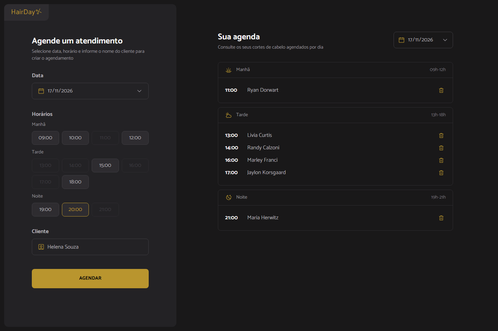
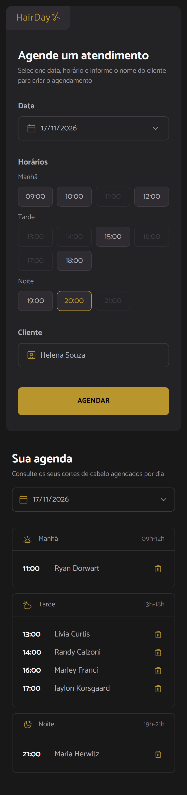

# HairDay ✂️

Aplicação de agendamentos para salão/barbearia, feita com **React + TypeScript** a partir de um
[layout no Figma](https://www.figma.com/design/RqcjirchSRj956Fz4BEkDH/Plataforma-de-agendamento--Community---Copy---c%C3%B3pia-?node-id=939-362).
Projeto prático desenvolvido com apoio de um agente de IA orientado pelo [`AGENTS.md`](AGENTS.md).

## Funcionalidades

- Cadastrar agendamento com **data**, **horário** e **nome do cliente**
- Validação do formulário (campos vazios, horário passado ou já ocupado)
- Agenda filtrada por dia, agrupada em **Manhã (09h–12h)**, **Tarde (13h–18h)** e **Noite (19h–21h)**
- Agendamentos em ordem cronológica
- Mensagem de período vazio: *"Você ainda não tem agendamentos cadastrados nesse período."*
- Excluir agendamento pela lixeira
- **Extras:** horários ocupados ficam bloqueados e os dados são salvos no `localStorage`
- Layout responsivo (desktop e celular)

## Tecnologias

- [React 19](https://react.dev/) — componentes, Props, `useState`, `useEffect`
- [TypeScript](https://www.typescriptlang.org/) — tipo `Appointment` e Props tipadas
- [Vite](https://vite.dev/) — ambiente de desenvolvimento e build
- CSS puro com variáveis (cores e tipografia do Figma) e fonte Catamaran

## Como executar

Pré-requisito: [Node.js](https://nodejs.org/) 20 ou superior.

```bash
git clone <url-deste-repositorio>
cd hairday
npm install
npm run dev
```

Acesse **http://localhost:5173**.

| Comando           | O que faz                           |
| ----------------- | ----------------------------------- |
| `npm run dev`     | Inicia o servidor de desenvolvimento |
| `npm run build`   | Verifica os tipos e gera a versão de produção |
| `npm run lint`    | Analisa o código com ESLint         |
| `npm run preview` | Abre a versão de produção           |

## Estrutura

```
src/
├── components/          # componentes visuais (.tsx + .css)
│   ├── ScheduleSidebar  # painel esquerdo
│   ├── AppointmentForm  # formulário: data, horários, cliente
│   ├── AppointmentList  # agenda do dia
│   ├── PeriodSection    # card de Manhã / Tarde / Noite
│   ├── AppointmentItem  # linha: horário, cliente, lixeira
│   └── DateInput, TextInput, TimeSlot, Button, Logo, Icons
├── types/appointment.ts # tipo Appointment
├── utils/               # períodos, datas e localStorage
└── App.tsx              # estado principal (lista de agendamentos)
```

### Como os dados circulam

- **Cadastro:** `AppointmentForm` valida e chama `onSubmit` → `App` cria o `id` e faz
  `setAppointments(current => [...current, novo])`.
- **Listagem:** `AppointmentList` usa `filter()` (data escolhida), `sort()` (horário) e
  `reduce()` (agrupa por período); `map()` renderiza os cards e as linhas.
- **Exclusão:** a lixeira chama `onDelete(id)` → `App` faz
  `setAppointments(current => current.filter(a => a.id !== id))`.

## Screenshots

| Desktop | Mobile |
| ------- | ------ |
|  |  |

## Uso de IA

O agente foi configurado pelo [`AGENTS.md`](AGENTS.md) como um desenvolvedor front-end
React + TypeScript especializado no HairDay, trabalhando em tarefas pequenas (um commit por etapa).

### Context7 MCP

<!-- Adicione aqui o print da consulta ao Context7 (ex.: docs/evidencias/context7.png) -->

### Playwright MCP

<!-- Adicione aqui o print do teste com Playwright (ex.: docs/evidencias/playwright.png) -->
